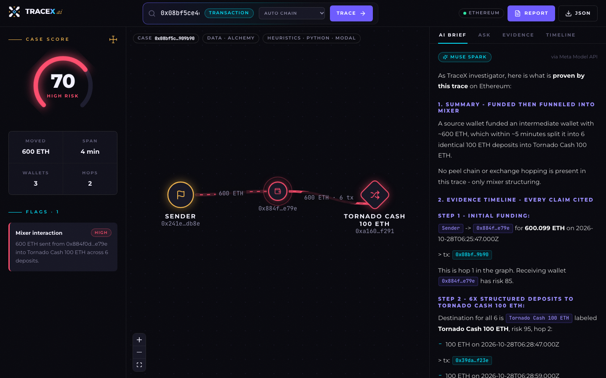
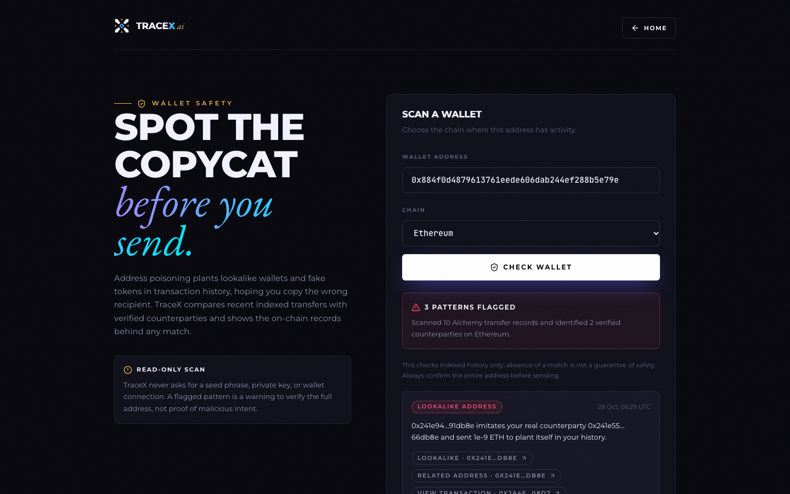
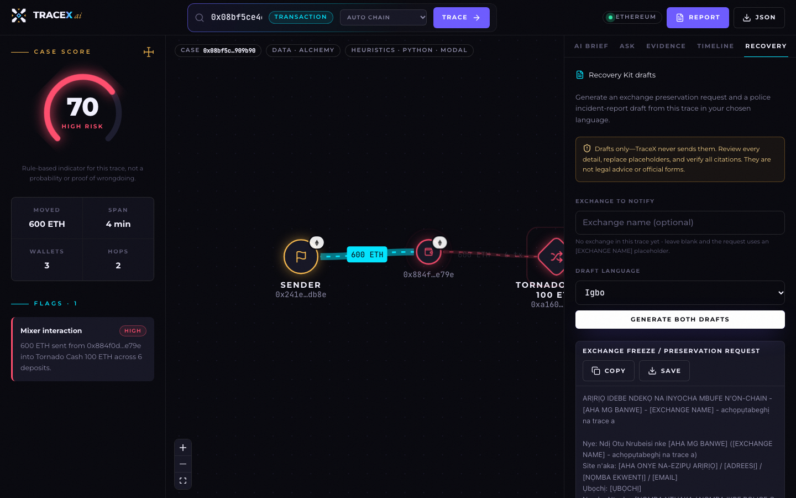
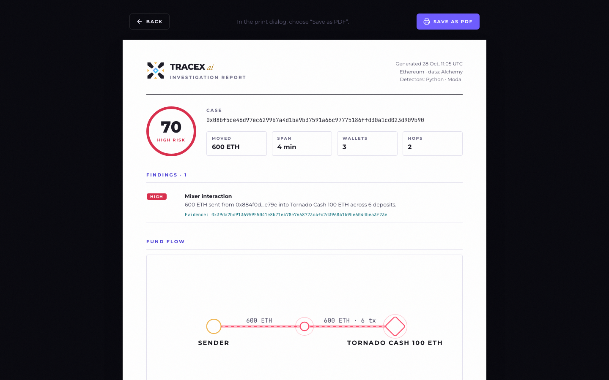
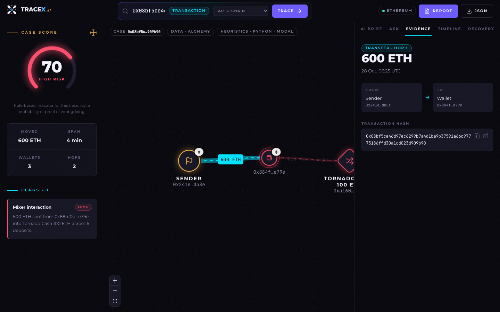
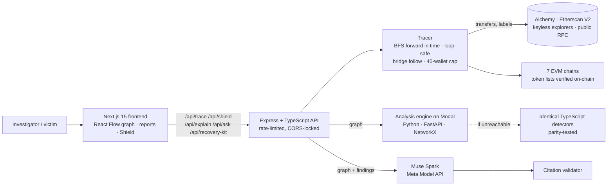

<div align="center">

# TraceX AI

### Follow the money. *Prove it.*

AI-powered blockchain forensics that traces cryptocurrency flows across seven chains, flags laundering patterns with deterministic detectors, and turns on-chain data into evidence-backed briefs, reports and recovery drafts - with **Meta's Muse Spark** citing a transaction hash for every claim.

**Built in Enugu, Nigeria, for the [Meta Global AI Developer Hackathon 2026](https://cerebralvalley.ai/e/meta-ai-developer-hackathon)** · Indie track · *Build for Your World*


**[▶ Demo video (2:58)](#demo)** · **[A real case](#a-real-case-traced-end-to-end)** · **[How it works](#architecture)** · **[Run it](#run-it-locally)**



</div>

---

## The problem

When crypto is stolen, the trail is public - but reading it is not. Block explorers show raw transfers, one address at a time. Following stolen funds across wallets, mixers and chains takes an analyst hours, and the tools that automate it are priced for enterprises and law-enforcement agencies.

So a scam victim in Enugu - or anywhere - is left with a transaction hash and no way to answer the questions that matter: *Where did my money go? Did it hit an exchange that could freeze it? What do I tell the police?*

## What TraceX makes possible

Paste a transaction hash, wallet address or ENS name. In seconds TraceX:

| | |
|---|---|
| **Traces** the money forward in time across **7 EVM chains** - Ethereum, Base, BNB Chain, Arbitrum, Optimism, Polygon and Robinhood Chain. Tx hashes are auto-detected on whichever chain they live on, and canonical bridges are followed to the destination chain. | **Detects** mixer deposits and withdrawals, peel chains, high-velocity movement, exchange cash-outs, exchange hopping and bridge exits - deterministic rules in Python/NetworkX, deployed on **Modal**, each finding citing its transaction. |
| **Explains** the case with **Muse Spark** via the **Meta Model API**: a plain-English brief and follow-up Q&A where every claim cites a tx hash - click any citation to jump to that transfer in the graph. | **Recovers**: the **Recovery Kit** drafts a records-preservation request for the exchange and a police incident report - in **English, Nigerian Pidgin, Igbo, Yoruba or Hausa** - and rejects any draft that invents a wallet or skips a transaction. |
| **Protects**: **Poisoning Shield** finds address-poisoning attacks in a wallet's history - look-alike addresses, fake tokens and spoofed zero-value transfers - before you copy the wrong address. | **Proves**: export a printable **evidence report** (score, findings, graph, AI brief, every tx hash) as PDF, or the full case as JSON. |

What wasn't possible before: a victim, in their own language, going from a transaction hash to a cited investigation and ready-to-review recovery documents in about a minute, for free.

## Demo

**▶ [Watch the 2:58 narrated walkthrough](https://youtube.com/)** *(link added on upload)* - recorded from the live app on a real mainnet case: real Alchemy data, the deployed Modal engine and live Muse Spark responses, including Recovery Kit drafts in Igbo. Captions are uploaded with the video.

The video is reproducible: [`tools/demo-video`](tools/demo-video) narrates each scene, drives the app with a scripted cursor and builds the MP4.

## A real case, traced end to end

On **28 Oct 2026**, wallet `0x884f…e79e` received **600.099 ETH** and within five minutes moved all of it into **Tornado Cash's 100 ETH pool** in six deposits. TraceX ([`docs/demo-cases.md`](docs/demo-cases.md)):

1. Paste [`0x08bf5ce4…909b90`](https://etherscan.io/tx/0x08bf5ce46d97ec6299b7a4d1ba9b37591a66c97775186ffd30a1cd023d909b90) with *Auto chain* - found on Ethereum.
2. Traces sender → wallet → Tornado Cash: **600 ETH · 6 tx**, one grouped high-severity finding, case score **70 / High risk** (~6 s).
3. Muse Spark writes the brief, citing all six deposit hashes and the funding transaction.
4. The same wallet was being **address-poisoned**: two look-alike senders (`0x241e94…db8e`, `0x241b22…db8e`) copying the real funder `0x241e55…db8e`, plus a **fake "ETH" token** for the exact same 600.099 amount. Paste the fake-token tx and TraceX refuses it - it only follows real assets. Poisoning Shield flags all three.

These exact checks run as live tests: `npm run test:live`.

| Poisoning Shield | Recovery Kit (Igbo) |
|---|---|
|  |  |

| Evidence report (PDF) | Cited evidence |
|---|---|
|  |  |

## How TraceX uses Meta AI

| Meta product | Where | What it does |
|---|---|---|
| **Muse Spark** (`muse-spark-1.3`) via **Meta Model API** | [`backend/src/lib/meta.ts`](application/backend/src/lib/meta.ts) | Investigation brief, follow-up Q&A, Recovery Kit drafts in five languages |

Design choices that make the model trustworthy for forensics:
- **Evidence in, citations out.** The model never sees raw chain data it could misread - it gets the traced graph and the deterministic findings, and must cite a transaction hash for every claim. The UI turns every hash into a clickable citation.
- **Drafts are validated, not trusted.** Recovery Kit output is parsed and checked: every transaction in the case must be cited, and no wallet outside the case may appear. Failing drafts are retried, then rejected ([`recovery.ts`](application/backend/src/services/recovery.ts)).
- **Reasoning budget tuned.** Muse Spark reasons before it answers and reasoning tokens count against `max_tokens`; TraceX sizes the budget and uses `reasoning_effort: low` (~10-15 s per brief).
- **No silent fakes.** If no AI provider is reachable the API fails loudly and the UI shows a clearly labelled rule-based summary - never placeholder text dressed up as AI.

Fireworks and Baseten adapters exist as optional Llama 3.3 70B fallbacks (OpenAI-compatible); they were **not** used for this submission.

## Architecture



| Layer | Stack |
|---|---|
| Frontend | Next.js 15, React 18, TypeScript, Tailwind, React Flow (`@xyflow/react`), Lucide |
| API | Node 20, Express, TypeScript, Zod, ethers v6, OpenAI-compatible SDK |
| Detectors | Python 3.12, FastAPI, NetworkX - deployed on **Modal** (`modal_app.py`); TypeScript copy as fallback |
| AI | Muse Spark via Meta Model API |
| Data | Alchemy (all 7 chains), Etherscan V2, Blockscout / Routescan / Optimism explorer (keyless), publicnode RPC |
| Storage | None needed - traces are computed on demand with a short in-memory cache |
| Ops | Dockerfiles, docker-compose, Render blueprint (`render.yaml`) |

**Supported chains:** Ethereum · Base · BNB Chain · Arbitrum · Optimism · Polygon · Robinhood Chain - each with its native coin plus verified stablecoins and wrapped native tokens ([`chains.ts`](application/backend/src/services/chains.ts), verified with `scripts/check-chains.ts`). Exchange hot-wallet labels (Binance, Coinbase, Kraken, OKX, Bybit, Crypto.com) and canonical bridge contracts were each checked against their public Etherscan labels.

## Engineering quality

| Suite | What it covers | Run |
|---|---|---|
| Backend unit + integration (26) | Real HTTP API in-process: validation, error codes, rate limiting, CORS, no-key AI failure; poisoning look-alike rules; bridge matching; Recovery Kit parsing and citation validation | `cd application/backend && npm test` |
| Backend live (4, opt-in) | Real mainnet cases: 600 ETH into Tornado, fake-token refusal, Shield imposters, Robinhood auto-detect | `npm run test:live` |
| Analysis engine (8) | Detectors, scoring, HTTP endpoint, **parity with the TypeScript detectors** on shared fixtures | `cd application/analysis-engine && .venv/bin/python -m pytest` |
| Frontend (13) | Scoring (incl. parity with the backend), formatting, sample-case integrity, rule-based brief, layout | `cd application/frontend && npm test` |

All suites pass on the submitted commit; each package also typechecks, lints and builds cleanly.

## Run it locally

```bash
# 1. backend API -> http://localhost:4000
cd application/backend
cp .env.example .env          # add META_API_KEY and ALCHEMY_API_KEY
npm install && npm run dev

# 2. frontend -> http://localhost:3300
cd application/frontend
npm install && npm run dev

# 3. optional: local detector engine (otherwise the deployed Modal URL or the built-in copy is used)
cd application/analysis-engine
python3 -m venv .venv && .venv/bin/pip install -r requirements-dev.txt
.venv/bin/uvicorn app.main:api --port 8100
```

| Key | Needed for | Get it |
|---|---|---|
| `META_API_KEY` | AI brief, Q&A, Recovery Kit (Muse Spark) | dev.meta.ai |
| `ALCHEMY_API_KEY` | Tracing on all 7 chains, Poisoning Shield | dashboard.alchemy.com (enable each network) |
| `ANALYSIS_ENGINE_URL` | Python detectors on Modal | `modal deploy modal_app.py` |
| `ETHERSCAN_API_KEY` | Optional backup data source | etherscan.io/myapikey |

No keys? The workspace still opens a clearly labelled synthetic sample case and offline demo cases. Full setup: [`application/README.md`](application/README.md).

## Project structure

```
application/
  frontend/          Next.js app - landing, investigation workspace, report, Poisoning Shield
  backend/           Express API - tracer, chains, sources, labels, bridges, shield, recovery, AI layer
  analysis-engine/   Python detectors (FastAPI + NetworkX) + Modal deployment + parity tests
tools/demo-video/    Reproducible narrated demo recording
docs/                Demo cases, submission notes, screenshots, timeline
```

## Limits, stated plainly

- TraceX is **read-only**. It never asks for keys or seed phrases and never sends documents.
- The case score is a **rule-based indicator**, not a probability or proof of wrongdoing.
- Traces are bounded (40 wallets, largest destinations per wallet) and stop at exchanges, mixers, bridges and contracts. Cross-chain follow covers supported canonical bridge events only.
- Labels cover major exchanges and bridges; an unlabelled address is not proof of anything.
- AI output can be wrong - which is why every claim is cited and every Recovery Kit draft is validated and must be reviewed by a human.

## Credits

Built by **Okokoh Benjamin** in Enugu, Nigeria. Design language inspired by West African visual tradition - Adinkra symbols (Akan, Ghana), Kente and Adire patterns. Licensed [MIT](LICENSE).
